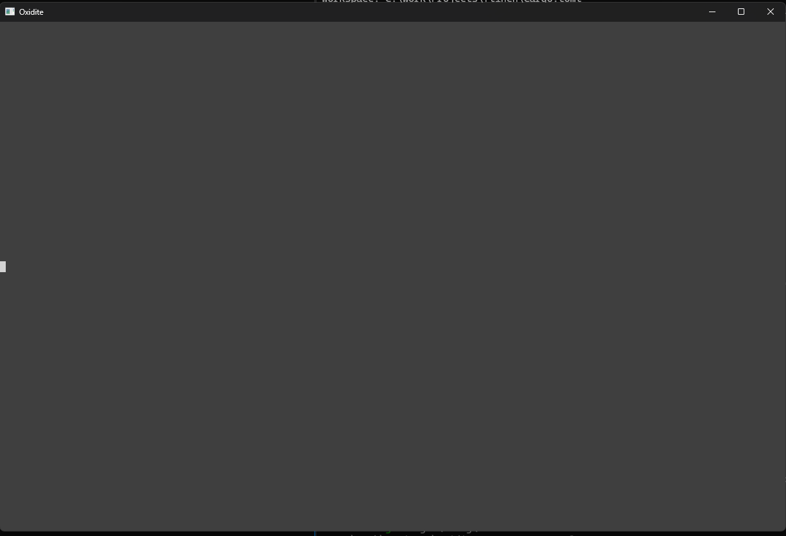

# Oxidite

A fast, cross-platform terminal emulator written entirely in Rust.

Oxidite is the **host window itself** (similar to Windows Terminal, Alacritty, or Ghostty). It is not a TUI application running inside another terminal, nor a wrapper around webviews or existing terminal crates. Oxidite spawns a real shell over a PTY, parses the raw ANSI/VT escape byte stream, manages its own terminal grid and scrollback history, renders that grid in a GPU-accelerated window, and translates keyboard/mouse input back to the shell.



---

## Features

- **GPU Accelerated Rendering**: Built with `wgpu` and `glyphon`, utilizing modern graphics APIs (DirectX 12 on Windows, Vulkan/Wayland on Linux, Metal on macOS).
- **Full VT / ANSI Standards**: Complete support for ANSI 16-color, 256-color palette, and 24-bit Truecolor (`\e[38;2;r;g;bm`).
- **Full Text Attributes**: Bold, dim, italic, underline, strikethrough, inverse video, and hidden text styles.
- **Alternate Screen Buffer**: Seamless support for full-screen interactive applications like `vim`, `nvim`, `htop`, `less`, and `top`.
- **Unicode & Wide Characters**: Automatic width measurement for CJK characters and emoji glyphs with accurate cursor alignment.
- **High-DPI & Dynamic Zoom**: Crisp font rendering across mixed DPI monitors with live zoom controls (`Ctrl+=`, `Ctrl+-`, `Ctrl+0`).
- **Live Theme Switching**: Built-in color presets (Dracula, Solarized Dark/Light, Gruvbox, Nord, One Dark) with instant cycling (`Ctrl+Shift+T`).
- **Live Hot Reloading**: Edits to `config.toml` automatically reload font size, padding, and active themes without restarting the terminal.
- **Robust Error Recovery**: "Never crash on bad config" policy with safe fallbacks and fuzz-tested VT parser resilience.
- **Mouse & Clipboard Integration**: Text selection, double-click selection, copy/paste (`Ctrl+Shift+C`, `Ctrl+Shift+V`), bracketed paste, and SGR 1006 mouse tracking.

---

## Architecture

The PTY -> Parser -> Grid -> Renderer pipeline is strictly decoupled:

```
Shell process
  │
  ▼
PTY Master (portable-pty)
  │
  ▼ (raw byte stream)
Reader Thread
  │
  ▼ (chunks over EventLoopProxy)
VT Parser (vte::Perform)
  │
  ▼ (Handler trait dispatch)
Terminal State (Grid, Cursor, Modes, Scrollback)
  │
  ▼ (damage-tracked dirty rows)
Renderer (wgpu + glyphon)
  │
  ▼
Window (winit)
```

Input and OS events follow the inverse path:

```
Window Events (Keyboard / Mouse / Resize / Paste)
  │
  ▼
Input Encoder (KeyEvent + Modes -> ANSI bytes)
  │
  ▼
PTY Writer
  │
  ▼
Shell process
```

---

## Installation & Building

### Prerequisites

- [Rust](https://rustup.rs/) (edition 2024, version 1.85+)
- Platform dependencies:
  - **Windows**: Windows 10+ (version 1809+ with ConPTY)
  - **Linux**: X11 or Wayland libraries:
    ```bash
    sudo apt-get install -y libxkbcommon-dev libxcb-render0-dev libxcb-shape0-dev libxcb-xfixes0-dev
    ```
  - **macOS**: macOS 11+ with Metal support

### Building from Source

Clone the repository and build with Cargo:

```bash
git clone https://github.com/your-username/oxidite.git
cd oxidite

# Run in development mode
cargo run

# Build an optimized release binary
cargo build --release
```

The compiled binary will be located at `target/release/oxidite` (or `oxidite.exe` on Windows).

---

## Usage & CLI Options

Launch Oxidite with your default system shell:

```bash
oxidite
```

Run a specific shell or command directly:

```bash
# Windows
oxidite -- pwsh.exe -NoLogo
oxidite -- cmd.exe /k "echo Hello from Oxidite"

# Linux / macOS
oxidite -- /bin/zsh -l
oxidite -- htop
```

### CLI Flags

- `--headless`: Run PTY in headless passthrough mode (stdin to PTY, PTY to stdout).
- `--dump-grid`: Spawn PTY, capture initial output, dump grid snapshot, and exit.
- `--help`, `-h`: Display help message and options.

---

## Default Keybindings

| Shortcut | Action |
|---|---|
| `Ctrl+Shift+C` | Copy selected text to system clipboard |
| `Ctrl+Shift+V` | Paste text from system clipboard |
| `Ctrl+=` / `Ctrl++` | Increase font size (Zoom In) |
| `Ctrl+-` | Decrease font size (Zoom Out) |
| `Ctrl+0` | Reset font size to default |
| `Ctrl+Shift+T` | Cycle through available themes live |
| `Shift+PageUp` | Scroll viewport up through history buffer |
| `Shift+PageDown` | Scroll viewport down through history buffer |

---

## Configuration

Oxidite loads configuration from `config.toml` in your standard platform config directory:
- **Windows**: `%APPDATA%\oxidite\config.toml`
- **Linux**: `~/.config/oxidite/config.toml`
- **macOS**: `~/Library/Application Support/oxidite/config.toml`

### Sample `config.toml`

```toml
# Active theme name
# Presets: "dracula", "solarized-dark", "solarized-light", "gruvbox-dark", "nord", "one-dark", "default-dark"
theme = "dracula"

# Font settings
font_family = "monospace"
font_size = 14.0

# Window inner padding in pixels
padding_x = 4.0
padding_y = 4.0

# Shell override (optional)
# shell = "pwsh.exe"
# shell_args = ["-NoLogo"]

# Scrollback buffer size
scrollback_lines = 10000

# Custom keybindings
[keybindings]
copy = "Ctrl+Shift+C"
paste = "Ctrl+Shift+V"
zoom_in = "Ctrl+="
zoom_out = "Ctrl+-"
zoom_reset = "Ctrl+0"
scroll_page_up = "Shift+PageUp"
scroll_page_down = "Shift+PageDown"
cycle_theme = "Ctrl+Shift+T"
```

See [docs/config.md](docs/config.md) for full theme specification and keybinding syntax.

---

## Performance & Benchmarks

Oxidite is engineered for high throughput and near-zero idle CPU consumption:
- Over **85 MB/s** ANSI escape stream processing throughput.
- Over **4 million lines per second** numerical dump throughput (`seq 1 100000` completes in ~0.024s without UI freezes).
- Row damage tracking and GPU glyph caching prevent redundant text reshaping.

Run the throughput benchmark suite:

```bash
cargo bench
```

Run property tests and fuzz testing:

```bash
# Run property tests
cargo test parser::properties

# Run 2,000 iterations of the parser fuzzer
cargo run --bin fuzz_parser -- --iterations 2000
```

---

## Tech Stack

| Component | Crate / Technology |
|---|---|
| **PTY** | `portable-pty` |
| **VT Tokenizer** | `vte` |
| **Windowing & Events** | `winit` |
| **GPU Rendering** | `wgpu` |
| **Text Layout & Glyphs** | `glyphon` |
| **Unicode Width** | `unicode-width` |
| **Config & Deserialization** | `toml`, `serde` |
| **Filesystem Watcher** | `notify` |
| **Clipboard** | `arboard` |
| **Logging** | `log`, `env_logger` |
| **Error Handling** | `thiserror`, `anyhow` |

---

## License

This project is licensed under the [MIT License](LICENSE).
