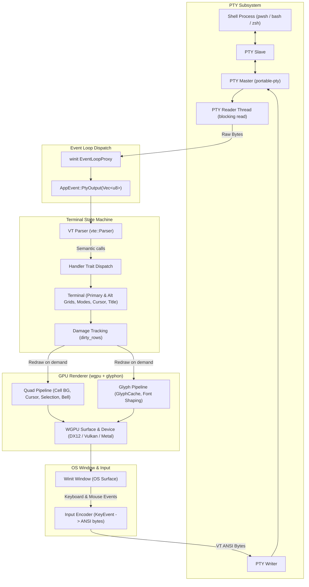
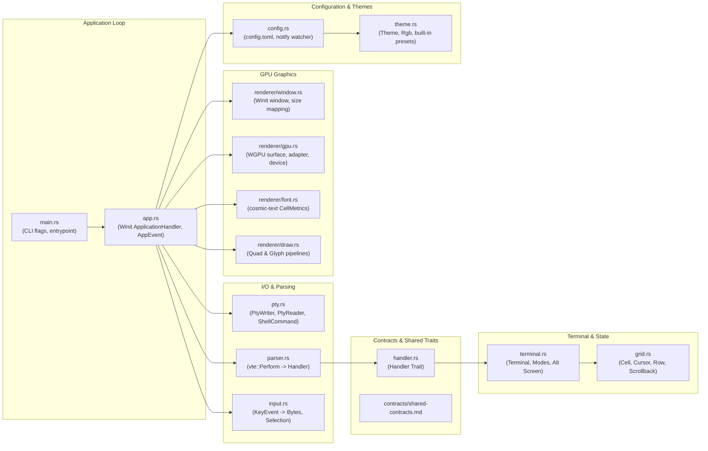

# Oxidite Architecture & Pipeline

Oxidite is an autonomous, cross-platform terminal emulator written entirely in Rust. It directly hosts the shell process over an operating system pseudoterminal (PTY), parses the ANSI/VT control byte stream, tracks terminal state and damage in an in-memory grid, and renders output using GPU-accelerated text and quad pipelines.

---

## 1. Core End-to-End Pipeline

---

## 2. Module Ownership & Package Boundaries

---

## 3. Data Flow Rules & Invariants

1. **Non-blocking UI Thread**: The main GUI event loop thread never blocks on PTY I/O. Reading occurs on a dedicated background thread, which communicates asynchronously via `EventLoopProxy<AppEvent>`.
2. **Single-threaded State Mutation**: Only the main UI thread mutates the `Terminal` and `Grid` state.
3. **On-Demand Redrawing**: The renderer redraws strictly upon damaged rows or visual timers (cursor blink, visual bell). When the terminal is idle, CPU usage sits near 0.0%.
4. **Coalesced Batching**: High-volume outputs (`cat`, `seq`) are coalesced in memory so that parsing occurs across combined buffers before issuing GPU render passes.
5. **Strict Hierarchy**:
   - `pty.rs` owns OS process spawning and pipes.
   - `parser.rs` owns escape tokenization with zero knowledge of cells or pixels.
   - `grid.rs` and `terminal.rs` maintain character grids with zero graphics dependencies.
   - `renderer/` inspects terminal state read-only to produce vertex buffers and glyph shapes.
   - `input.rs` inspects terminal modes read-only to produce byte sequences for the PTY.
